

  

<h1 align="center">Phorminx</h1>

<strong>Voice, disciplined.</strong>

  Local-first dictation, meetings and research notes for Windows. 
  Speak, keep searchable text, and use AI formatting without a paid AI service.

  
  
  
  

  
   
  <a href="https://phorminx.net">phorminx.net</a> ·
  <a href="docs/GETTING-STARTED.md">Getting started</a> ·
  <a href="docs/DEVELOPMENT.md">Build from source</a>

<picture>
  <source media="(prefers-color-scheme: dark)" srcset="docs/features/hero-dark.webp">
  <source media="(prefers-color-scheme: light)" srcset="docs/features/hero-light.webp">
  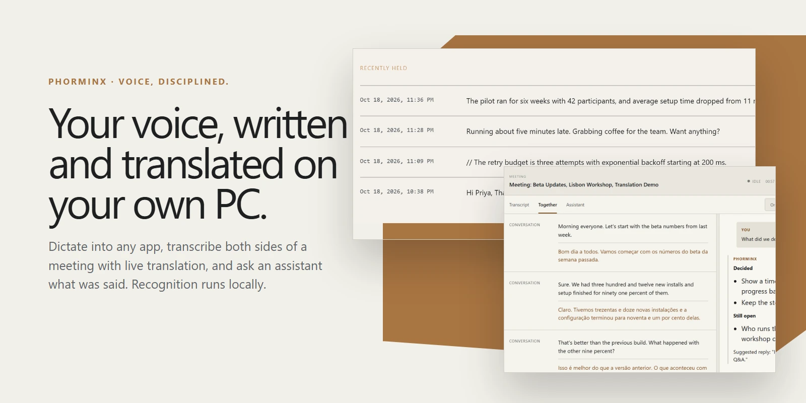
</picture>

Screenshots show the real app running on a demo profile filled with made-up content.
See <a href="docs/features/CAPTURE.md">how they are made</a>.

<table>
  <tr>
    <td align="center" width="33%"><a href="#dictation">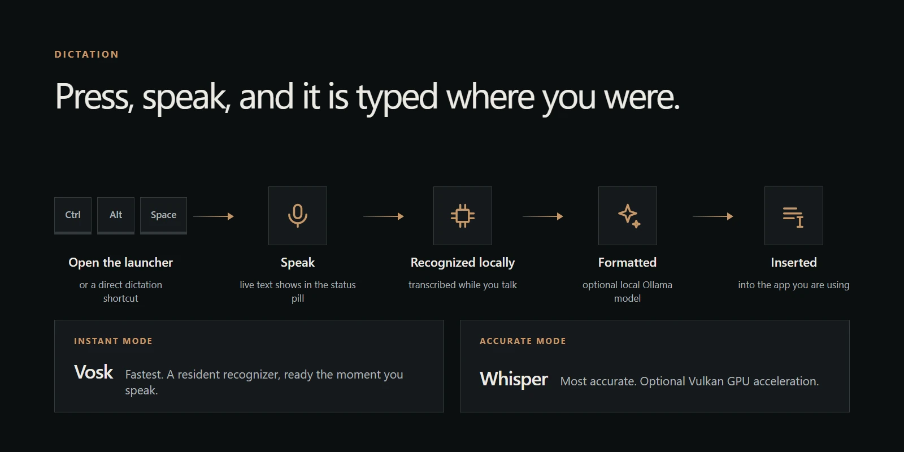 <b>Dictation</b></a></td>
    <td align="center" width="33%"><a href="#formatting-and-custom-instructions">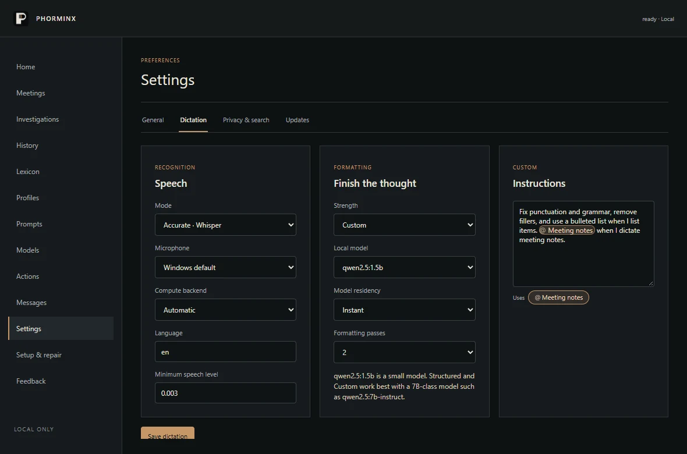 <b>Formatting</b></a></td>
    <td align="center" width="33%"><a href="#prompts-library">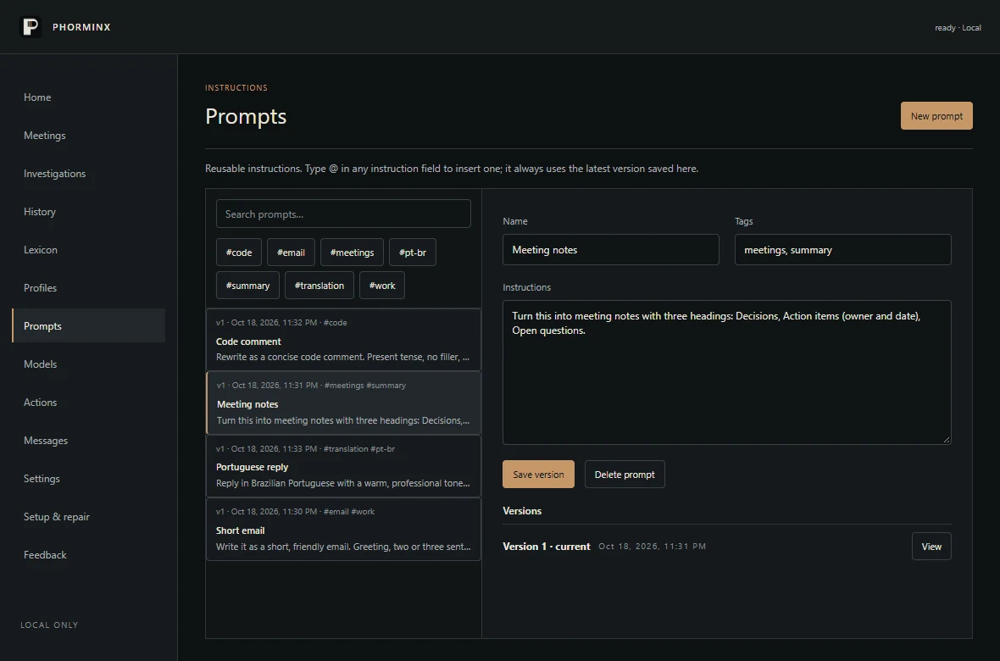 <b>Prompts</b></a></td>
  </tr>
  <tr>
    <td align="center"><a href="#meetings-and-live-translation">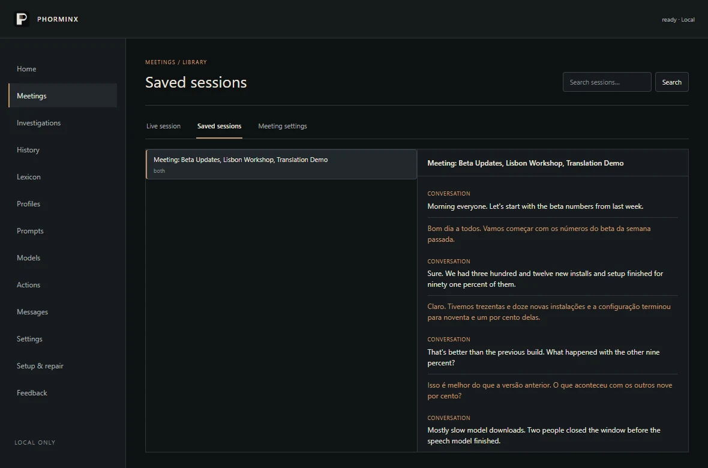 <b>Meetings</b></a></td>
    <td align="center"><a href="#companion-assistant">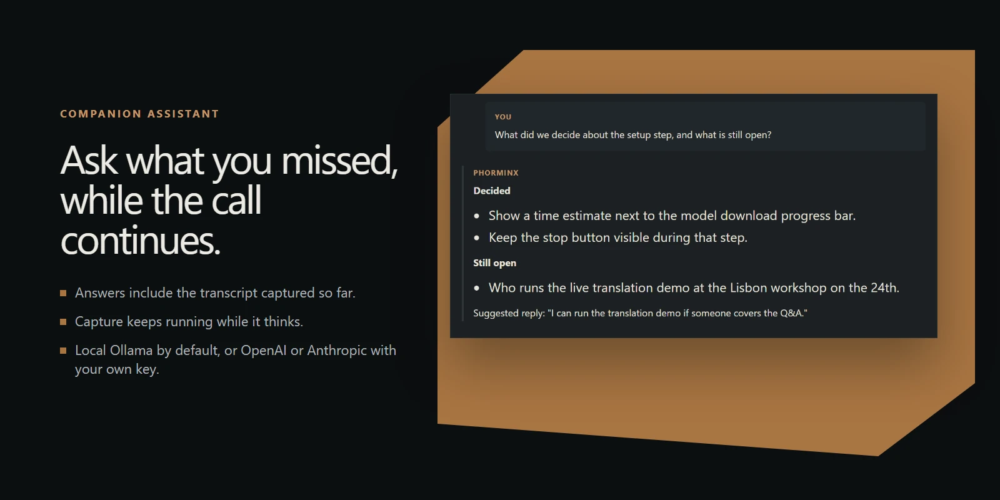 <b>Companion assistant</b></a></td>
    <td align="center"><a href="#investigations">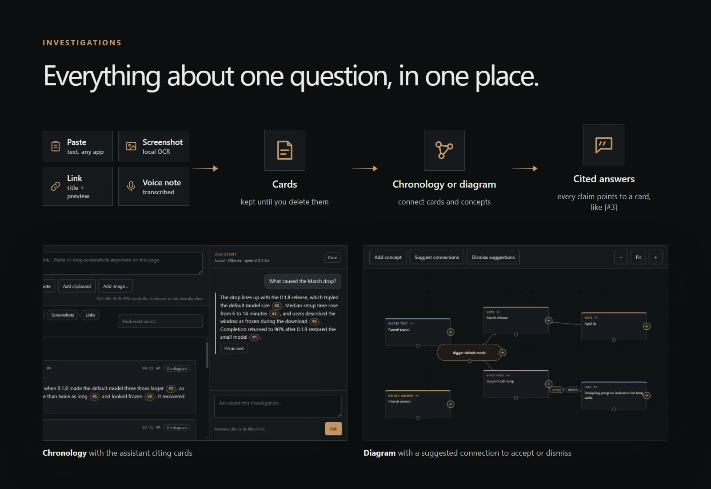 <b>Investigations</b></a></td>
  </tr>
  <tr>
    <td align="center"><a href="#messages">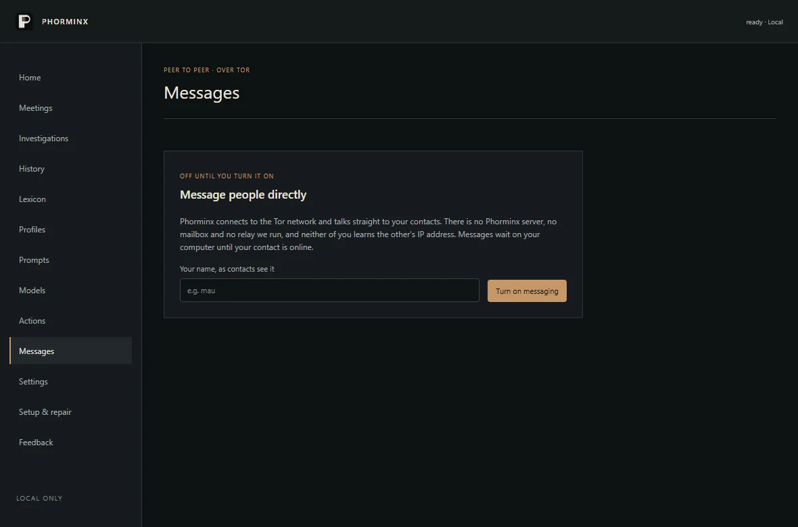 <b>Messages</b></a></td>
    <td align="center"><a href="#library-search">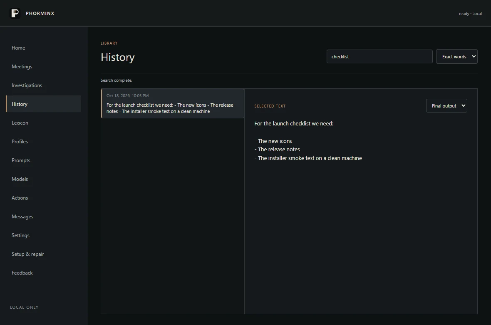 <b>Library search</b></a></td>
    <td align="center"><a href="#actions">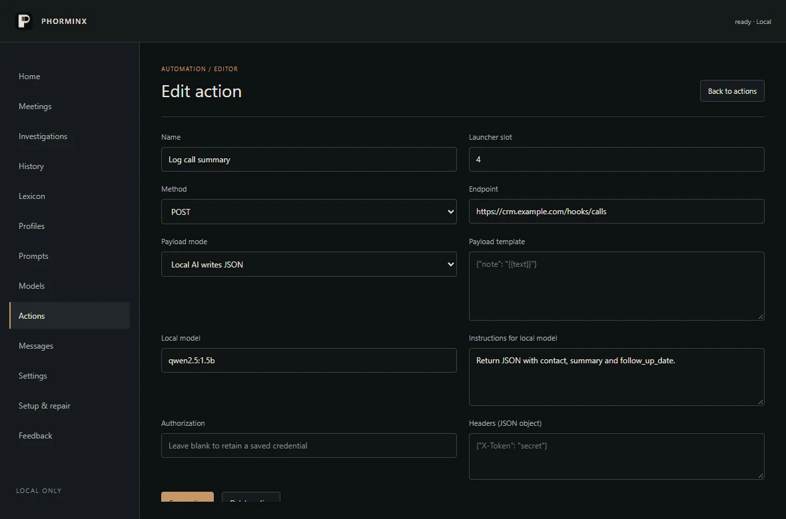 <b>Actions</b></a></td>
  </tr>
</table>

## Dictation

Press a shortcut, speak, and the text lands in whatever app you were using.
Recognition runs on your computer.

- **Instant** mode uses resident Vosk recognition; **Accurate** mode uses
  Whisper, with optional Vulkan acceleration.
- Transcription begins while you speak, using a bounded rolling audio buffer.
- **Live text** shows the last line or two of recognized speech in the status
  pill while you dictate (on by default, switchable in Settings).
- Hold-to-talk or toggle recording, from the `Ctrl+Alt+Space` launcher or an
  optional direct dictation shortcut.
- Dictations are kept in local history for 7 days by default; choose 1 day,
  30 days, indefinitely, or off.

## Review panel

Fix the last dictation without dictating it again. Open it from the status
pill's Expand button.

- Edit the text, then copy it or replace what was inserted.
- **Reformat** with another strength or a one-off instruction (which can use
  `@` prompts).
- **Replace** only updates the inserted text when it is still there and
  unchanged; otherwise the result goes to the clipboard.

No screenshot yet: the panel only opens after a live dictation, which
could not be recorded with synthetic audio on the capture machine.

## Formatting and custom instructions

Turn rambling speech into clean text with a local Ollama model, or skip AI
entirely and keep deterministic cleanup.

- Strengths from **Raw** to **Light**, **Balanced**, **Strong**, **Structured**
  and **Custom** instructions.
- **Formatting passes** run the model more than once, each pass refining the last.
- The **lexicon** maps how words are heard to how they should be written
  (names, products, jargon), optionally per language or app.
- **App profiles** change formatting style, instructions, language and
  insertion method for a specific program, or turn dictation off there.

## Prompts library

Named, tagged, versioned instructions you can reuse anywhere Phorminx asks
for instructions.

- Type `@` in any instruction field to insert a prompt; it shows as a chip.
- References always use the prompt's latest version: dictation formatting,
  app profiles, the review panel, the meeting assistant and AI-written Actions.
- Every save keeps a version you can restore.
- Deleting or renaming a prompt that is in use lists every place that refers to it first.

## Meetings and live translation

Capture computer audio and your microphone together, with timestamps and an
optional local translation beside the original.

- Dual-source capture runs two recognizers; mute either source for Phorminx
  without muting your call.
- Translation uses a separately selected local Ollama model and never
  replaces the original transcript.
- Show Original, Translation, or Both.
- Saved sessions are searchable by title, transcript and chat.

## Companion assistant

A resizable companion window keeps the transcript and an assistant beside the
conversation.

- **Transcript**, **Together** (split, with a draggable divider) and
  **Assistant** views.
- Asking a question includes newly captured transcript context without
  stopping capture.
- Use a local Ollama model, or choose OpenAI or Anthropic with your own key.
- Optional automatic commentary runs only through a verified local Ollama model.
- A configured local fallback model may retry a failed answer once; assistant
  failure never ends capture.

## Investigations

Collect everything about one question in one place: pasted text, notes,
screenshots, links, voice notes and pinned answers.

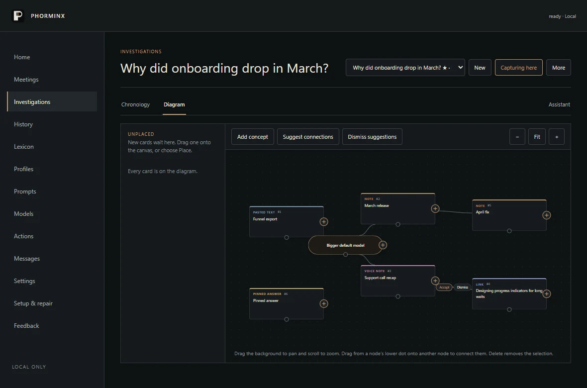

- See it as a **chronology** or as a **diagram** of connected cards and concepts.
- The assistant answers from your cards with citations like `[#3]`, and can
  suggest connections for you to accept or dismiss.
- Screenshot text is read by locally downloaded OCR models.
- A dedicated shortcut sends the clipboard to the active investigation from
  any app. Export an investigation as Markdown.

## Messages

Send text directly to people you add with a one-time invite, with no
Phorminx server in between. Off by default.

- Turning it on connects to the Tor network through the embedded Arti client.
- Neither side learns the other's IP address; contacts can see when you are online.
- A message only moves while both of you have Phorminx running.
- History stays on this computer and can be deleted per contact.

## And also

<table>
  <tr>
    <td width="50%" valign="top">
      <h3 id="library-search">Library search</h3>
      
      
Exact-word and optional local semantic search over retained
      dictations; saved meetings have their own search.

    </td>
    <td width="50%" valign="top">
      <h3 id="actions">Actions</h3>
      
      
Saved HTTP requests with transcript substitution or local
      model-written JSON, on launcher keys 3 to 9.

    </td>
  </tr>
  <tr>
    <td valign="top">
      <h3 id="models-and-setup">Models and setup</h3>
      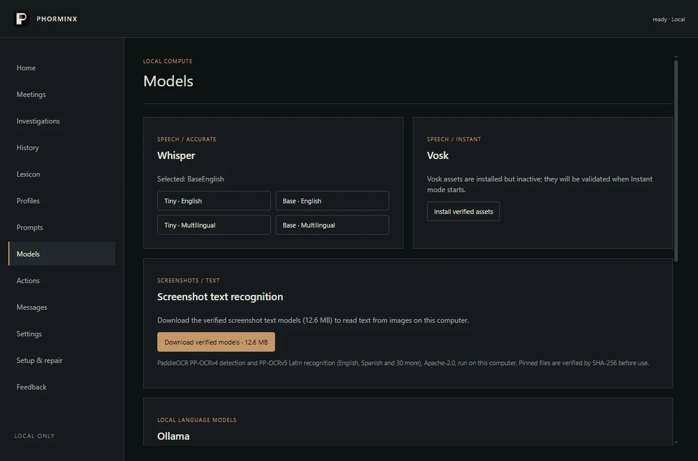
      
Hash-verified Whisper, Vosk and OCR downloads, Ollama models, and a
      guided setup that can prepare everything or repair one step.

    </td>
    <td valign="top">
      <h3 id="automatic-updates">Automatic updates</h3>
      
Release builds check GitHub Releases daily, verify signed metadata
      and installer hashes, and install when Phorminx is closed or idle,
      never during a recording. Both the daily check and automatic install
      can be turned off in Settings → Updates.

    </td>
  </tr>
</table>

## Privacy at a glance

<picture>
  <source media="(prefers-color-scheme: dark)" srcset="docs/features/privacy-dark.svg">
  <source media="(prefers-color-scheme: light)" srcset="docs/features/privacy-light.svg">
  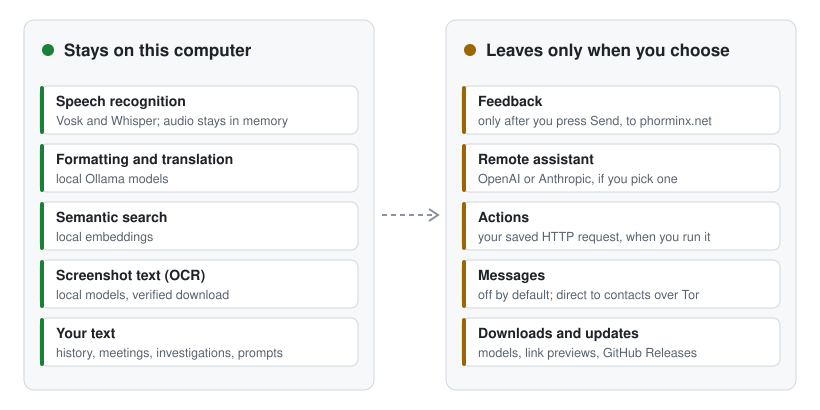
</picture>

Speech recognition runs locally. The production capture path keeps audio in
memory rather than saving recordings to disk. Retained text and settings live
under `%LOCALAPPDATA%\Phorminx`; use the application's history, session, and
deletion controls to manage stored text. Disabling dictation history does not
mean that separately saved meeting sessions have been deleted.

Local Ollama formatting and embeddings use local compute. Model downloads use
the network. Optional remote assistant providers and HTTP actions send the
configured text/context to the selected provider or destination. These options
are not a local-only privacy guarantee: remote providers may charge for usage
and apply their own data policies. Review the destination before enabling them.

Meeting translation uses a separately selected local Ollama model. Originals
remain available even if translation is unavailable or cannot keep up. Fresh
settings recommend `nomic-embed-text:latest`; existing embedding selections and
indexes are not silently replaced.

Investigations are kept until you delete them; dictation history retention does
not apply to them. Screenshots are stored as re-encoded PNG files beside the
database. Screenshot text recognition runs locally after an optional, verified
model download (12.6 MB). A pasted link is fetched once, without cookies, for its
title and preview; local and private-network addresses are never fetched.

**Messages** (off by default) sends text directly to people you add with a
one-time invite. Turning it on connects Phorminx to the Tor network through
the embedded Arti client; there is no Phorminx server, and neither side learns
the other's IP address. Contacts can see when you are online, and a message
only moves while both of you have Phorminx running. History stays on this
computer and can be deleted per contact. See
[ADR-018](docs/ADR-018-P2P-MESSAGING.md).

Launcher **0 · Give feedback** records a draft locally. Only clicking **Send**
submits its reviewed text to `phorminx.net`; optional diagnostics are shown
separately. Audio and logs are not attached automatically. Release-enabled
builds check stable GitHub Releases daily by default; automatic download and
install after exit are on by default, with an onboarding opt-out and a Settings
control. The app verifies signed metadata and installer hashes and
waits for exit before installing, never stopping an active recording. Builds
without a configured release-verification key cannot enable updates. Neither
feature makes an unconfigured feedback server ready.

Do not include real transcripts, recordings, credentials, or personal settings
in bug reports or contributions. Use synthetic examples instead.

## Getting started

1. **Install.** [Download the installer](https://github.com/impossibleG/phorminx/releases/latest/download/Phorminx-x64-setup.exe)
   for Windows 10/11 x64. Alpha builds are not Authenticode-signed yet, so
   SmartScreen may warn on first run.
2. **Prepare.** The setup window opens after installation. Choose
   **Prepare everything** for the English starter bundle (speech models,
   Ollama, a small local formatting model and local embeddings), or run
   individual steps. Ollama is optional; dictation works without AI formatting.
3. **Dictate.** Press `Ctrl+Alt+Space` to open the P launcher, choose Dictate,
   speak, and press the shortcut again to finish.

Phorminx is alpha software; accuracy, latency and compatibility depend on the
device, audio source and model. The [getting started guide](docs/GETTING-STARTED.md)
covers the PowerShell starter bundle, model choices and meeting audio tips.

## Documentation

- [Getting started](docs/GETTING-STARTED.md)
- [Build, test, and package](docs/DEVELOPMENT.md)
- [Windows compatibility checks](docs/WINDOWS-COMPATIBILITY-PROTOCOL.md)
- [Architecture decision records](docs/README.md)
- [Production brand assets](design/brand/README.md)
- [Assistant transport contracts](crates/phorminx-assistant/README.md)
- [Meeting capture and translation](docs/MEETING-CAPTURE-AND-TRANSLATION.md)
- [Setup and operations release gates](docs/ADR-017-RELIABLE-SETUP-AND-MEETINGS.md)
- [Setup and meetings acceptance checklist](docs/SETUP-MEETINGS-TEST-CHECKLIST.md)
- [Investigations and local OCR](docs/ADR-018-INVESTIGATIONS-AND-LOCAL-OCR.md)
- [Peer-to-peer messaging](docs/ADR-018-P2P-MESSAGING.md)
- [Prompt library](docs/ADR-019-PROMPT-LIBRARY.md)
- [Recreating the README screenshots](docs/features/CAPTURE.md)

## License

Phorminx's original source is licensed under the [MIT License](LICENSE).
Third-party libraries, runtimes, and downloaded models retain their respective
licenses and notices; the project license does not replace those terms.
