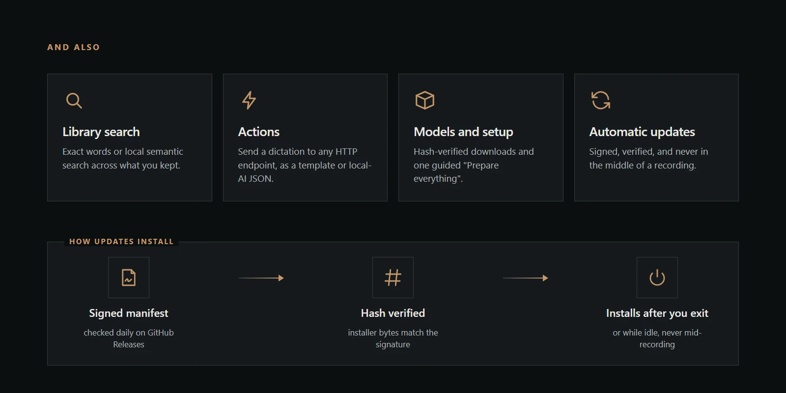

  

<h1 align="center">Phorminx</h1>

<strong>Voice, disciplined.</strong>

  Local-first dictation, meetings and research notes for Windows. 
  Speak, keep searchable text, and use AI formatting without a paid AI service.

  
  
  
  

  
   
  <a href="https://phorminx.net">phorminx.net</a> ·
  <a href="docs/GETTING-STARTED.md">Getting started</a> ·
  <a href="docs/DEVELOPMENT.md">Build from source</a>

<picture>
  <source media="(prefers-color-scheme: dark)" srcset="docs/features/hero-dark.webp">
  <source media="(prefers-color-scheme: light)" srcset="docs/features/hero-light.webp">
  
</picture>

  <a href="#dictation">Dictation</a> ·
  <a href="#formatting-and-custom-instructions">Formatting</a> ·
  <a href="#prompts-library">Prompts</a> ·
  <a href="#meetings-and-live-translation">Meetings</a> ·
  <a href="#companion-assistant">Assistant</a> ·
  <a href="#investigations">Investigations</a> ·
  <a href="#messages">Messages</a> ·
  <a href="#privacy-at-a-glance">Privacy</a>
   Product images are crops of the real app running on a demo profile with made-up content
  (<a href="docs/features/CAPTURE.md">how they are made</a>).

## Dictation

- Transcription starts while you speak; live text shows in the status pill.
- Hold-to-talk or toggle, from the launcher or a direct dictation shortcut.
- History is kept 7 days by default (1 day, 30 days, forever, or off).

### Review panel

Open the last dictation from the status pill's Expand button to edit it,
**Reformat** it with another strength or a one-off instruction, copy it, or
**Replace** the inserted text. Replace only touches text that is still there
and unchanged; otherwise the result goes to the clipboard.

## Formatting and custom instructions

- Strengths from **Raw** to **Light**, **Balanced**, **Strong**, **Structured** and **Custom**.
- **Formatting passes** run the local model more than once, each pass refining the last.
- A **lexicon** fixes names and jargon; **app profiles** change style, language or
  insertion per program, or turn dictation off there.

## Prompts library

Named, tagged, versioned instructions. Type `@` in any instruction field
(formatting, app profiles, the review panel, the meeting assistant or Actions)
to insert one; it always uses the latest version.

## Meetings and live translation

- Computer audio and your microphone are captured together, with timestamps.
- Pause either source for Phorminx without muting your call.
- Show Original, Translation or Both; saved sessions are searchable.

## Companion assistant

A resizable companion keeps the transcript and assistant beside the call, in
Transcript, Together or Assistant view. Optional automatic commentary runs
only on a verified local Ollama model, and a failed answer never ends capture.

## Investigations

A dedicated shortcut sends the clipboard to the active investigation from any
app. The assistant can suggest connections for you to accept or dismiss, and
any investigation can be exported as Markdown.

## Messages

Add people with a one-time invite. A message only moves while both of you have
Phorminx running. See [ADR-018](docs/ADR-018-P2P-MESSAGING.md).

## And also

- **Library search:** exact-word and optional local semantic search; saved meetings have their own search.
- **Actions:** saved HTTP requests with transcript substitution or local-model JSON, on launcher keys 3 to 9.
- **Models and setup:** Whisper, Vosk and OCR downloads are hash-verified; **Prepare everything** sets up the starter bundle.
- **Automatic updates:** daily checks and automatic install can both be turned off in Settings → Updates.

## Privacy at a glance

<picture>
  <source media="(prefers-color-scheme: dark)" srcset="docs/features/privacy-dark.svg">
  <source media="(prefers-color-scheme: light)" srcset="docs/features/privacy-light.svg">
  
</picture>

<b>Privacy details</b>

Speech recognition runs locally. The production capture path keeps audio in
memory rather than saving recordings to disk. Retained text and settings live
under `%LOCALAPPDATA%\Phorminx`; use the application's history, session, and
deletion controls to manage stored text. Disabling dictation history does not
mean that separately saved meeting sessions have been deleted.

Local Ollama formatting and embeddings use local compute. Model downloads use
the network. Optional remote assistant providers and HTTP actions send the
configured text/context to the selected provider or destination. These options
are not a local-only privacy guarantee: remote providers may charge for usage
and apply their own data policies. Review the destination before enabling them.

Meeting translation uses a separately selected local Ollama model. Originals
remain available even if translation is unavailable or cannot keep up. Fresh
settings recommend `nomic-embed-text:latest`; existing embedding selections and
indexes are not silently replaced.

Investigations are kept until you delete them; dictation history retention does
not apply to them. Screenshots are stored as re-encoded PNG files beside the
database. Screenshot text recognition runs locally after an optional, verified
model download (12.6 MB). A pasted link is fetched once, without cookies, for its
title and preview; local and private-network addresses are never fetched.

**Messages** (off by default) sends text directly to people you add with a
one-time invite. Turning it on connects Phorminx to the Tor network through
the embedded Arti client; there is no Phorminx server, and neither side learns
the other's IP address. Contacts can see when you are online, and a message
only moves while both of you have Phorminx running. History stays on this
computer and can be deleted per contact. See
[ADR-018](docs/ADR-018-P2P-MESSAGING.md).

Launcher **0 · Give feedback** records a draft locally. Only clicking **Send**
submits its reviewed text to `phorminx.net`; optional diagnostics are shown
separately. Audio and logs are not attached automatically. Release-enabled
builds check stable GitHub Releases daily by default; automatic download and
install after exit are on by default, with an onboarding opt-out and a Settings
control. The app verifies signed metadata and installer hashes and
waits for exit before installing, never stopping an active recording. Builds
without a configured release-verification key cannot enable updates. Neither
feature makes an unconfigured feedback server ready.

Do not include real transcripts, recordings, credentials, or personal settings
in bug reports or contributions. Use synthetic examples instead.

## Getting started

1. **Install.** [Download the installer](https://github.com/impossibleG/phorminx/releases/latest/download/Phorminx-x64-setup.exe)
   for Windows 10/11 x64. Alpha builds are not Authenticode-signed yet, so
   SmartScreen may warn on first run.
2. **Prepare.** The setup window opens after installation. Choose
   **Prepare everything** for the English starter bundle (speech models,
   Ollama, a small local formatting model and local embeddings), or run
   individual steps. Ollama is optional; dictation works without AI formatting.
3. **Dictate.** Press `Ctrl+Alt+Space` to open the P launcher, choose Dictate,
   speak, and press the shortcut again to finish.

Phorminx is alpha software; accuracy, latency and compatibility depend on the
device, audio source and model. The [getting started guide](docs/GETTING-STARTED.md)
covers the PowerShell starter bundle, model choices and meeting audio tips.

## Documentation

- [Getting started](docs/GETTING-STARTED.md)
- [Build, test, and package](docs/DEVELOPMENT.md)
- [Windows compatibility checks](docs/WINDOWS-COMPATIBILITY-PROTOCOL.md)
- [Architecture decision records](docs/README.md)
- [Production brand assets](design/brand/README.md)
- [Assistant transport contracts](crates/phorminx-assistant/README.md)
- [Meeting capture and translation](docs/MEETING-CAPTURE-AND-TRANSLATION.md)
- [Setup and operations release gates](docs/ADR-017-RELIABLE-SETUP-AND-MEETINGS.md)
- [Setup and meetings acceptance checklist](docs/SETUP-MEETINGS-TEST-CHECKLIST.md)
- [Investigations and local OCR](docs/ADR-018-INVESTIGATIONS-AND-LOCAL-OCR.md)
- [Peer-to-peer messaging](docs/ADR-018-P2P-MESSAGING.md)
- [Prompt library](docs/ADR-019-PROMPT-LIBRARY.md)
- [Recreating the README visuals](docs/features/CAPTURE.md)

## License

Phorminx's original source is licensed under the [MIT License](LICENSE).
Third-party libraries, runtimes, and downloaded models retain their respective
licenses and notices; the project license does not replace those terms.
