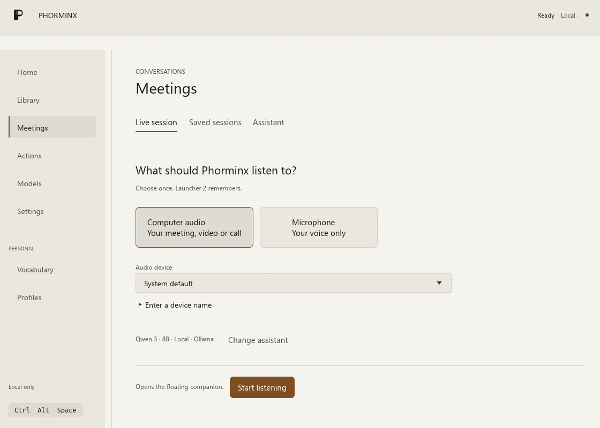
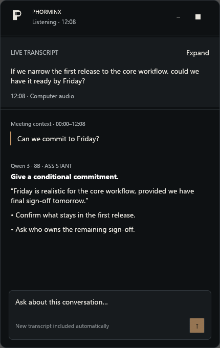

<p align="center">
  
</p>

<h1 align="center">Phorminx</h1>

<p align="center"><strong>Voice, disciplined.</strong></p>

Local-first dictation and meeting assistance for Windows. Turn speech into text,
keep searchable notes, and use optional AI formatting without requiring a paid
AI service.

<p align="center">
  <a href="docs/DEVELOPMENT.md">Build from source</a> ·
  <a href="#what-it-does">Features</a> ·
  <a href="#privacy-and-network-access">Privacy</a>
</p>



<p align="center"><sub>The Meetings workspace. Screenshots use synthetic demo data.</sub></p>

## What it does

- **Dictation:** resident Vosk recognition for Instant mode, or Whisper with
  optional Vulkan acceleration for Accurate mode. Transcription begins while
  speaking, using a bounded rolling audio buffer.
- **Formatting:** deterministic cleanup and an optional local Ollama model,
  with configurable formatting strength, a personal lexicon, and app profiles.
- **Meetings:** computer audio and microphone together, with source labels and timestamps;
  optional local translation preserves the original transcript. A resizable companion
  offers transcript, assistant, and split views. Asking the assistant includes newly
  captured transcript context without stopping capture. Optional automatic commentary
  runs only through a verified local Ollama model.
- **Library:** exact-word and optional local semantic search over retained text.
- **Actions:** saved HTTP requests with transcript substitution or optional
  model-generated JSON, accessible from the launcher.
- **Desktop controls:** configurable shortcuts, light/dark appearance,
  model management, and setup/repair tools.
- **Operations:** review-and-send voice feedback and opt-in signed update support.
  These require configured server storage and release signing before public use.

### Keep the meeting in view

The normal, resizable companion puts the live transcript and assistant beside the
conversation. Choose Original, Translation, or Both; resize the split or focus on
one pane. Ask a question with the latest transcript context while capture
continues. Independent controls pause Phorminx's transcription of your mic or
computer audio; they do not mute your call.

<p align="center">
  
</p>

## Getting started

Phorminx targets Windows 10/11 x64. It is alpha software; recognition accuracy,
latency, and compatibility depend on the device, audio source, and model.

Build from source using the [development guide](docs/DEVELOPMENT.md).
Speech models and Vosk runtime assets are separate downloads and are not
included in this source repository. Configure them in the application's setup
and model screens. Ollama is optional; dictation can run without AI formatting.

The branded installer opens Phorminx's setup window after installation. Choose
**Prepare everything** to install the local starter bundle without a terminal,
or review individual repair steps. Progress and errors appear in Phorminx; a
safe stop finishes the current step first. Use **Prepare Phorminx** in the Start
menu to retry. Silent updates skip this onboarding. Setup preserves existing
settings and saved text.

For an already installed app, an English starter bundle can be downloaded and
configured automatically. Close Phorminx (including its tray icon), then run
this from the repository folder in **64-bit PowerShell as your normal user**:

```powershell
powershell.exe -NoProfile -ExecutionPolicy Bypass -File .\scripts\Initialize-Phorminx.ps1
```

The script downloads Vosk's English model/runtime, Whisper base.en, installs
Ollama and the Vulkan runtime if missing, and pulls `qwen2.5:1.5b` for formatting
and `nomic-embed-text` for semantic search. Allow several GB of free disk space
and time for downloads. Windows may request administrator approval for Vulkan.
The speech assets are hash-verified and installers are publisher-verified.
On a fresh installation it configures Instant mode, balanced formatting, and
local semantic search. Existing settings and saved text are preserved; existing
installations may need to select the downloaded models in Settings/Models.
The script can be rerun after a failed download. Add `-Plan` to preview its scope
without changing anything. It is also standalone: the script file can be shared
alongside the app installer, without requiring a repository checkout.

This does **not** install Phorminx itself, source-build tools, or GPU drivers.
Vulkan acceleration needs a compatible GPU/vendor driver; installing the Vulkan
runtime alone does not establish GPU compatibility. This starter downloads
English models, not every available language or model variant.

The default `Ctrl+Alt+Space` shortcut opens the P launcher. Choose Dictate, speak,
then press the shortcut again to finish. Settings provides shortcut and
appearance preferences. Meetings and Actions have their own workspaces.

Models also offers curated English Vosk choices ranging from a small download to
multi-gigabyte models. Downloads do not switch the active model: explicitly choose
**Use for English Instant** after setup. Native validation runs in the background.
Larger models require more memory and are not guaranteed to improve every voice.
Dual-source meetings run two recognizers; headphones help avoid speaker audio
being transcribed a second time through the microphone. Meeting settings save
the input and output devices separately for the next session. A configured,
installed small local fallback model may retry a failed assistant response once;
assistant failure never ends capture.

## Privacy and network access

Speech recognition runs locally. The production capture path keeps audio in
memory rather than saving recordings to disk. Retained text and settings live
under `%LOCALAPPDATA%\Phorminx`; use the application's history, session, and
deletion controls to manage stored text. Disabling dictation history does not
mean that separately saved meeting sessions have been deleted.

Local Ollama formatting and embeddings use local compute. Model downloads use
the network. Optional remote assistant providers and HTTP actions send the
configured text/context to the selected provider or destination. These options
are not a local-only privacy guarantee: remote providers may charge for usage
and apply their own data policies. Review the destination before enabling them.

Meeting translation uses a separately selected local Ollama model. Originals
remain available even if translation is unavailable or cannot keep up. Fresh
settings recommend `nomic-embed-text:latest`; existing embedding selections and
indexes are not silently replaced.

**Messages** (off by default) sends text directly to people you add with a
one-time invite. Turning it on connects Phorminx to the Tor network through
the embedded Arti client; there is no Phorminx server, and neither side learns
the other's IP address. Contacts can see when you are online, and a message
only moves while both of you have Phorminx running. History stays on this
computer and can be deleted per contact. See
[ADR-018](docs/ADR-018-P2P-MESSAGING.md).

Launcher **0 · Give feedback** records a draft locally. Only clicking **Send**
submits its reviewed text to `phorminx.net`; optional diagnostics are shown
separately. Audio and logs are not attached automatically. Release-enabled
builds check stable GitHub Releases daily by default; automatic download and
install after exit are on by default, with an onboarding opt-out and a Settings
control. The app verifies signed metadata and installer hashes and
waits for exit before installing, never stopping an active recording. Builds
without a configured release-verification key cannot enable updates. Neither
feature makes an unconfigured feedback server ready.

Do not include real transcripts, recordings, credentials, or personal settings
in bug reports or contributions. Use synthetic examples instead.

## Documentation

- [Build, test, and package](docs/DEVELOPMENT.md)
- [Windows compatibility checks](docs/WINDOWS-COMPATIBILITY-PROTOCOL.md)
- [Architecture decision records](docs/README.md)
- [Production brand assets](design/brand/README.md)
- [Assistant transport contracts](crates/phorminx-assistant/README.md)
- [Meeting capture and translation](docs/MEETING-CAPTURE-AND-TRANSLATION.md)
- [Setup and operations release gates](docs/ADR-017-RELIABLE-SETUP-AND-MEETINGS.md)
- [Setup and meetings acceptance checklist](docs/SETUP-MEETINGS-TEST-CHECKLIST.md)

## License

Phorminx's original source is licensed under the [MIT License](LICENSE).
Third-party libraries, runtimes, and downloaded models retain their respective
licenses and notices; the project license does not replace those terms.
